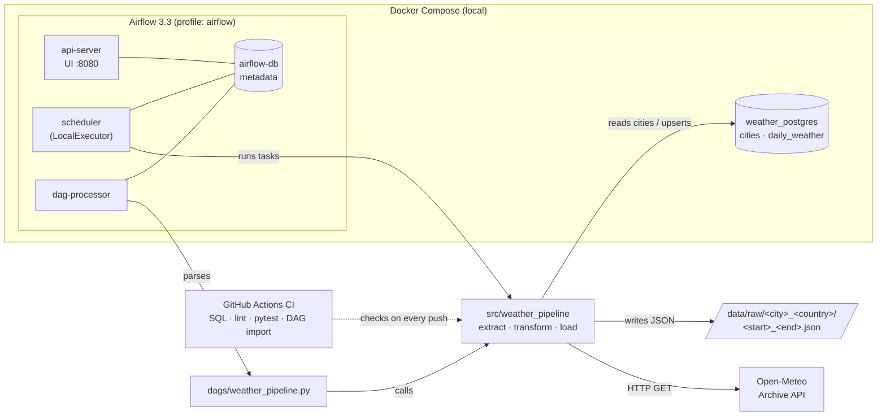
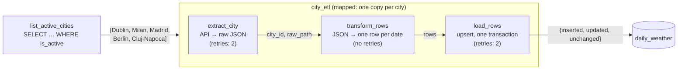
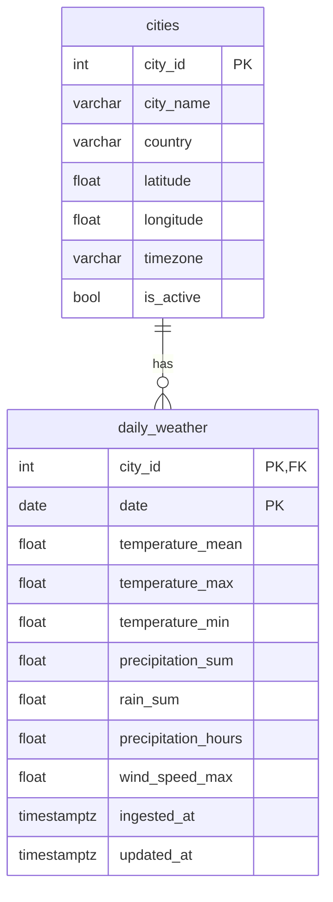

# European Weather Analytics Pipeline


An end-to-end data engineering pipeline that ingests historical daily weather data for five European cities from the [Open-Meteo Historical Weather API](https://open-meteo.com/en/docs/historical-weather-api), stores the raw responses, transforms them into clean daily records and loads them into PostgreSQL. Apache Airflow orchestrates the pipeline.

The goal of the project is to demonstrate how to build a **reliable** pipeline: idempotent loads, isolated failures per city, preserved raw data, and automated checks in CI.

> **Note:** Open-Meteo's historical data comes from weather models and reanalysis. It is not direct measurements from weather stations.

## Cities

| City | Country | Time zone |
|---|---|---|
| Dublin | Ireland | Europe/Dublin |
| Milan | Italy | Europe/Rome |
| Madrid | Spain | Europe/Madrid |
| Berlin | Germany | Europe/Berlin |
| Cluj-Napoca | Romania | Europe/Bucharest |

Cities are stored in the `cities` table, not hardcoded. To add a city, insert a row. To pause one, set `is_active = FALSE`.

## Tech stack

| Area | Technology |
|---|---|
| Language | Python 3.12 |
| Storage | PostgreSQL 16 |
| Orchestration | Apache Airflow 3.3 (LocalExecutor) |
| Containers | Docker Compose |
| Testing and linting | pytest, ruff |
| CI | GitHub Actions |

## Architecture



- **Weather data and Airflow's metadata live in separate databases.** Airflow internals never mix with project data.
- **The pipeline logic is plain Python** in `src/weather_pipeline`. The DAG is a thin wrapper around it, so the logic can be tested and run without Airflow.

## Pipeline flow



1. **List cities:** read every active city from the `cities` table.
2. **Extract:** for each city, call the Open-Meteo archive API for the requested date range and save the raw JSON response unchanged in `data/raw/`.
3. **Transform:** convert the API's column-oriented response (parallel lists) into one row per date and rename fields to match the database columns. Missing values stay `NULL`; they're never treated as zero.
4. **Load:** upsert the rows into `daily_weather` in a single transaction and report how many were inserted, updated or unchanged.

## Data model



- **One row per city per day:** the primary key `(city_id, date)` makes duplicate observations impossible.
- **Constraints reject impossible values:** for example negative precipitation, precipitation hours outside 0–24, or a minimum temperature above the maximum.
- **Weather columns are nullable:** missing data is recorded as missing, not as zero.

## Design decisions

| Decision | Why |
|---|---|
| **Keep raw API responses** | Data can be reprocessed or debugged without calling the API again. |
| **Idempotent upsert** (`ON CONFLICT … DO UPDATE … WHERE … IS DISTINCT FROM`) | Reruns never create duplicates. Rows are only updated, and `updated_at` only changes, when a value actually changed. |
| **One transaction per load** | If any row fails a constraint, the whole batch is rolled back. A city is never left half-loaded. |
| **Mapped task group per city** | One city failing (for example an API error) doesn't block the others, and retries apply only to the failed city. |
| **No retries on transform** | A malformed file fails the same way every time, so retrying wastes time. |
| **Cities in the database, not in code** | Cities can be added or paused without code changes. |
| **Short database connect timeout** | Tasks fail within seconds when the database is down, instead of hanging for minutes. |

## Project structure

```
├── dags/
│   └── weather_pipeline.py      # Airflow DAG (thin wrapper around src/)
├── docker/
│   └── airflow.Dockerfile       # Airflow image with this package installed
├── scripts/
│   └── check_dag_imports.py     # Used by CI to check DAGs import cleanly
├── sql/
│   ├── 01_table_schema.sql      # Tables and constraints
│   └── 02_cities_data.sql       # Seed data for the five cities
├── src/weather_pipeline/
│   ├── config.py                # Settings from environment / .env
│   ├── db.py                    # Connections and city lookups
│   ├── extract.py               # API call + raw JSON storage
│   ├── transform.py             # Raw JSON → rows
│   ├── load.py                  # Idempotent upsert
│   └── __main__.py              # CLI for running extraction without Airflow
├── tests/                       # pytest unit and database tests
├── docker-compose.yml
└── pyproject.toml
```

## Getting started

### Prerequisites

- Docker Desktop. Airflow needs about 4 GB of memory available to Docker.
- Python 3.11 or newer, for running tests and the CLI locally.

### 1. Configure

```bash
cp .env.example .env    # then change POSTGRES_PASSWORD
```

### 2. Start the database

```bash
docker compose up -d
```

On first start, PostgreSQL runs the scripts in `sql/` to create the tables and add the five cities. They only run when the database volume is empty.

### 3. Start Airflow

```bash
docker compose --profile airflow up -d --build
```

Open http://localhost:8080 and log in with `airflow` / `airflow`. Change these in `.env` with `AIRFLOW_ADMIN_USER` and `AIRFLOW_ADMIN_PASSWORD`.

### 4. Run the pipeline

1. In the Airflow UI, open **`weather_pipeline`** and switch it on.
2. Click **Trigger**, choose a start and end date, and confirm.
3. Each city appears as its own mapped task. The `load_rows` output shows how many rows were inserted, updated or unchanged.

Check the result:

```bash
docker exec -it weather_postgres psql -U weather_user -d weather_db \
  -c "SELECT c.city_name, COUNT(*) AS days, MIN(date), MAX(date)
      FROM daily_weather JOIN cities c USING (city_id)
      GROUP BY c.city_name;"
```

### Stopping

```bash
docker compose --profile airflow down    # data is kept
docker compose down -v                   # also deletes the weather database
```

## Development

```bash
python -m venv .venv
source .venv/bin/activate                # Windows: .venv\Scripts\Activate.ps1
pip install -e ".[dev]"

ruff check . && ruff format --check .    # lint
pytest                                   # tests
```

- **Database tests** run against the database configured in `.env`. Each test uses a temporary city and rolls back its changes, so no data is left behind. If the database isn't running, these tests are skipped.
- **Extraction without Airflow:**

  ```bash
  python -m weather_pipeline --city Dublin --country Ireland --start 2026-10-01 --end 2026-10-07
  ```

## CI

Every push to `main` and every pull request runs:

| Job | Checks |
|---|---|
| SQL scripts | The scripts apply cleanly to a fresh PostgreSQL, can be re-run safely, and seed five cities. |
| Python lint | `ruff check` and `ruff format --check`. |
| Python tests | `pytest` against a PostgreSQL service container. |
| Airflow image and DAG imports | The Airflow image builds and every DAG imports without errors. |

## Roadmap

- [x] PostgreSQL schema and seed data in Docker
- [x] Extract, transform and load with idempotent upserts
- [x] Airflow orchestration with per-city failure isolation
- [x] Automated tests and CI

## License

[Apache License 2.0](LICENSE)
